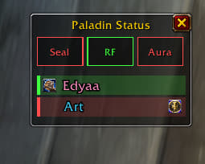

# Sealkeeper: Forever

**[Available on CurseForge](https://www.curseforge.com/wow/addons/sealkeeper)**

Stop staring at your buff bar. **Sealkeeper: Forever** is a Paladin addon built for chill, low-stress raiding and dungeon runs on **WoW: Forever** — it watches your Seal, Righteous Fury, and Aura for you, and keeps you honest about whether your party is actually getting your Blessing, so you can just play instead of babysitting timers.



## Features

- **Seal / Righteous Fury / Aura alerts** — a popup banner and/or sound the instant one of these drops off, with an optional early warning a few seconds before it expires. Never get caught with a dead Seal mid-pull again.
- **Party Blessing tracking** — tracks whether *your* Blessing specifically (not just "a" Blessing from any paladin) is up on each party member, so you always know who still needs a buff.
- **Movable status window** — a small always-on panel with three badges (Seal / RF / Aura, icons by default, switchable to plain text) that light up red when something's missing, plus one row per party member:
  - **Your own Blessing icon on the left** of the name, **another paladin's Blessing icon on the right** — at a glance you can tell if someone's covered, and by whom.
  - Rows turn green when the player has your Blessing, red when they don't, and grey with an **"(offline)"** or **"(out of range)"** label when you can't reach them.
  - **Click a row to cast a Blessing on that member directly** — plain click = Blessing of Kings, Ctrl-click = Might, Shift-click = Wisdom by default, and each one is reassignable in the settings panel. No targeting, no macros to set up yourself, and it never misfires onto your current target or yourself.
  - Drag it anywhere, or right-click for a quick menu: resize, lock the window in place, hide it, or jump to the full settings panel.
  - Optional minimal look — hide the title and close button, just the badges and rows.
- **Fully configurable** — pick your own sounds (built-in presets or a custom file), per-alert volume, colors, text size, and messages for every alert, all from an in-game settings panel (slash commands work too, if you prefer those).
- **Alert throttle** — a minimum gap between repeat alerts for the same buff, so a flickering connection doesn't turn one dropped Seal into a sound-spam.
- **Class-colored names** — party rows are colored by class so your raid frames and the status window always agree at a glance.

## Installation

1. Download the latest release and unzip it.
2. Copy the `PaladinSealAlert` folder into your `World of Warcraft\_classic_beta_\Interface\AddOns\` directory.
3. Restart the game or reload your UI (`/reload`).

## Getting started

Type `/sealalert options` in-game to open the full settings panel, or `/sealalert` for a list of every slash command. A quick sample:

```
/sealalert sound on|off
/sealalert group on|off
/sealalert scale 1.2
/sealalert blessing ctrl wisdom
/sealalert options
```

## Known limitations (WoW: Forever beta)

This addon was built and tested during the first weeks of the WoW: Forever beta, which has a few client-side quirks worth knowing about:

- **Custom sound files** (`PlaySoundFile`) are currently silent on this client — a client bug, not an addon bug. Stick to the built-in sound presets until Blizzard fixes it.
- **Buff reads are blocked entirely while you're in combat.** This is a deliberate client restriction (aura data is hidden from addons during combat), so the status window shows the last known state instead of live data until combat ends. Click-to-cast still works mid-fight — it doesn't need a fresh aura read.
- **Click-cast bindings can't be changed while in combat.** Protected click attributes are frozen during a fight; reassign a Blessing to a different click type between pulls instead.
- **"Out of range" detection is best-effort.** Range checks are subject to the same anti-automation restriction as buff reads on this client, so a member who's actually out of range may not always get flagged — offline detection is unaffected and always accurate.

None of these affect the addon's core alerting — they only limit what's possible during combat lockdown and with custom audio.
